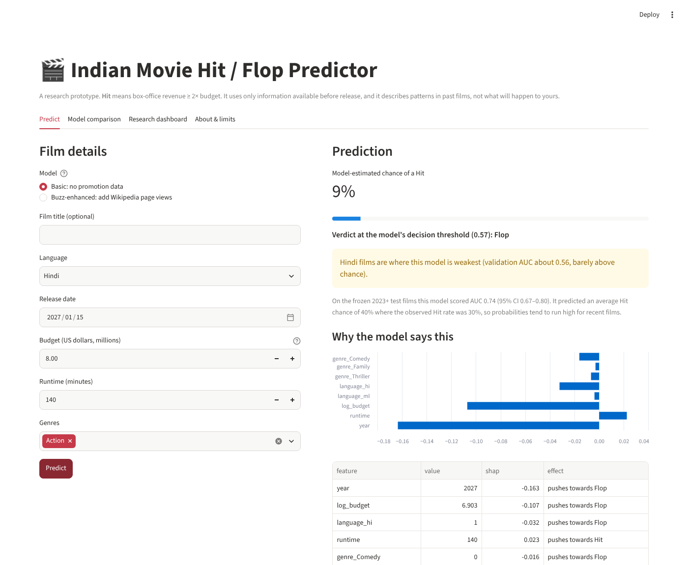
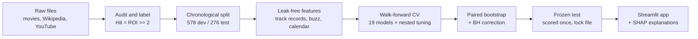
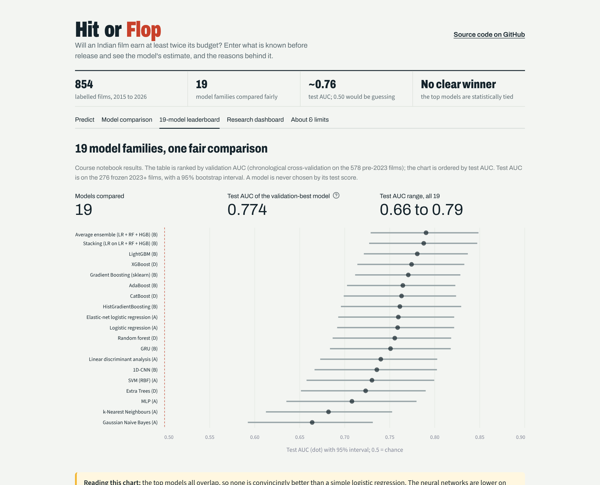
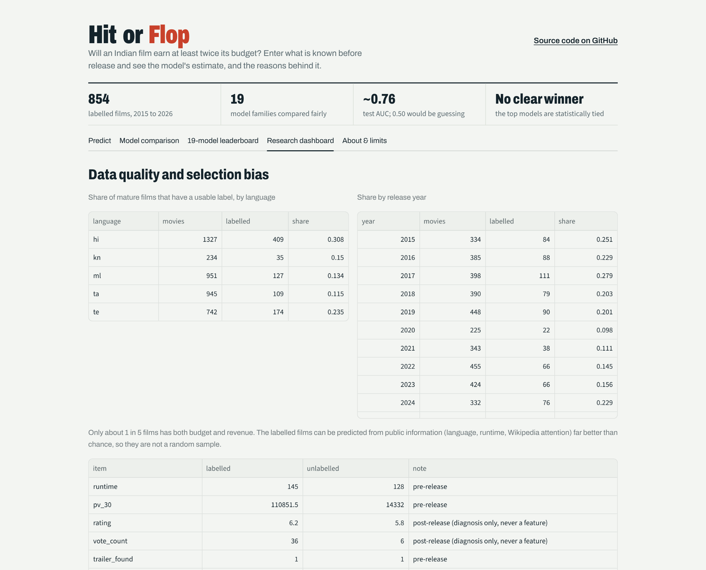

<div align="center">

# 🎬 Indian Movie Hit / Flop Prediction

**Can we tell, before release, whether an Indian film will earn at least twice its budget?**
A leak-free, chronologically validated machine-learning study of 854 films, with 19 models compared and an interactive app.

[](https://github.com/tonymadhuri2088-cmd/movie-hit-flop/actions)
[](https://movie-hit-flop-predictor.streamlit.app/)


[](LICENSE)

[**Live app**](https://movie-hit-flop-predictor.streamlit.app/) · [Results](#results) · [How it works](#how-it-works) · [Quick start](#quick-start) · [What is done](docs/WHAT_IS_DONE.md) · [Model card](docs/MODEL_CARD.md) · [Roadmap](docs/IMPROVEMENTS.md)



</div>

> The free live app sleeps when idle. If it shows "Wake up", click once and wait about a minute.

## Highlights
- **Honest evaluation.** Hit = revenue / budget >= 2. Every split is chronological (never shuffled): 578 development films before 2023, and **276 frozen test films from 2023 onward, scored once**.
- **19 model families** (logistic regression to gradient boosting, stacking and neural networks) compared with paired bootstrap and Benjamini-Hochberg correction.
- **Leak-free features.** Cast, crew and studio track records use only earlier films. Tests flip future labels and prove earlier features do not move.
- **A real, tested product.** 81 automated tests, GitHub Actions CI, a Streamlit app with per-prediction SHAP explanations, and a Dockerfile.

## Results
Test AUC on the 276 frozen 2023+ films (0.50 = chance), with 95% bootstrap intervals:

| Model | Features | Validation AUC | Test AUC (95% CI) |
|---|---|---|---|
| XGBoost (best on validation) | base + Wikipedia + YouTube | 0.730 | 0.774 (0.714 to 0.833) |
| HistGradientBoosting (cross-validation choice) | base + Wikipedia | 0.714 | 0.761 (0.696 to 0.830) |
| Random forest | base + Wikipedia + YouTube | 0.706 | 0.756 (0.687 to 0.818) |
| Logistic regression (simple baseline) | base | 0.690 | 0.759 (0.692 to 0.822) |
| MLP / 1D-CNN / GRU | various | 0.61 to 0.68 | 0.71 / 0.74 / 0.75 |

<p align="center"></p>

Full table: [`docs/MODEL_LEADERBOARD.md`](docs/MODEL_LEADERBOARD.md).

**What this shows**
1. **Hits can be ranked better than chance** (test AUC about 0.76), but only moderately. At its chosen threshold the main model finds about 35% of Hits and 91% of Flops.
2. **No model is convincingly better than logistic regression.** All paired-bootstrap intervals include 0 on the held-out period, so the top model families are statistically tied.
3. **Neural networks do not help.** They are lower on validation and no better on test, as expected with 578 training films.
4. **Pre-release "buzz" (Wikipedia page views, YouTube trailer statistics) adds little.** In the research package, 0 of 48 feature-set comparisons were convincing, and tuning and ensembling did not help either.
5. **The ceiling is the data, not the algorithm.** Budget and language dominate. See the [roadmap](docs/IMPROVEMENTS.md) for what would actually move the needle.

## How it works

More detail: [`docs/ARCHITECTURE.md`](docs/ARCHITECTURE.md).

## Two parts
| Part | What it is | Where |
|---|---|---|
| **A. Course notebook** | One notebook that compares **19 model families** end to end. Runs in Google Colab in about 30 minutes. | `notebooks/01_course_notebook_19_models.ipynb`, results in `docs/course_notebook_results/` |
| **B. Research package** | The same question as a tested Python package: nested tuning, ensembles, calibration, SHAP, a frozen test set scored once, and the Streamlit app. | `hitflop/`, `tests/`, `app/`, `outputs/` |

The two parts use different feature sets and validation set-ups, so exact numbers differ slightly (for example HistGradientBoosting test AUC 0.761 in A and 0.735 in B). The conclusions agree.

## Research upgrade
The project is being upgraded phase by phase into a research-grade study without touching the original split, test lock or results. Rules, findings and status are in [`docs/UPGRADE_LOG.md`](docs/UPGRADE_LOG.md). Phase 0 (protocol) and Phase 1 (advanced evaluation) are done:
```bash
python -m hitflop.upgrade_phase1 outputs/upgrade/part_a_test_predictions.pkl   # all metrics, intervals and confusion matrices
```

## Tech stack
| Area | Tools |
|---|---|
| Language | Python 3.11+ |
| Data | pandas, NumPy, SciPy |
| Classic models | scikit-learn (logistic regression, random forest, HistGradientBoosting, SVM, kNN, Naive Bayes, LDA, AdaBoost, Extra Trees), XGBoost, LightGBM, CatBoost |
| Neural networks (Part A) | PyTorch (MLP, GRU, 1D-CNN) |
| Tuning and explanation | Optuna (nested chronological tuning), SHAP, permutation importance |
| Features | `holidays` package for festival and holiday calendars |
| Statistics | paired bootstrap, Benjamini-Hochberg correction |
| App | Streamlit, Altair |
| Quality | pytest (81 tests), GitHub Actions CI, Docker |
| Notebook | Google Colab / Jupyter, matplotlib, seaborn |

## Data and split
- 854 films with both budget and revenue: **578 development (released before 2023-01-01)** and **276 frozen test (2023 onward)**. Seed 42.
- Features known before release: budget, language, genre, runtime, release timing and festivals, Wikipedia page-view rates, YouTube trailer statistics, and cast/crew/studio track records (only from films released at least 120 days earlier).
- The test set is scored once. In Part B a lock file (`outputs/final/TEST_SCORED.lock`) refuses a second run.

## The app
Five tabs: **Predict** (film details in; chance of a Hit, a colour-coded verdict with the decision threshold, per-input SHAP bars, honest warnings, CSV download, and quick example films), **Model comparison**, **19-model leaderboard**, **Research dashboard** (data quality, robustness, experiment log) and **About & limits**.

<p align="center">


</p>

## Quick start
```bash
git clone https://github.com/tonymadhuri2088-cmd/movie-hit-flop.git
cd movie-hit-flop
pip install -r requirements.txt
python -m pytest -q tests          # 81 tests: cohort, leakage, folds, metrics, protocol, calibration, app
streamlit run app/streamlit_app.py
```
**Part A (notebook):** open `notebooks/01_course_notebook_19_models.ipynb` in Google Colab and choose Runtime > Run all (about 30 minutes). The first cell downloads the two data files automatically; if that fails, Colab shows an upload button, so upload `data/movies_full.csv` and `data/yt_features.csv` from this repo. Locally, also run `pip install -r requirements-notebook.txt`.

**Docker** (the Dockerfile is written but has not been build-tested yet):
```bash
docker build -t movie-hit-flop .
docker run -p 8501:8501 movie-hit-flop   # then open http://localhost:8501
```

**Re-create Part B results:**
```bash
python -m hitflop.pipeline_phase1; python -m hitflop.phase3; python -m hitflop.phase45
python -m hitflop.final            # scores the frozen test set ONCE (lock file)
python -m hitflop.artifacts; python -m hitflop.phase6
```

## Repository map
```
hitflop/        package: data, features, history (leak-free records), models, validation, metrics,
                calibration, tuning (nested Optuna), ensembles, explain (SHAP), predict, final
tests/          81 tests, including leakage tests that flip future labels and check earlier features do not move
app/            Streamlit app (.streamlit/ holds the theme)
notebooks/      01 = 19-model course notebook, 02 = upgrade experiments
experiments/    append-only experiment log (every experiment, settings and result)
outputs/        Part B tables and figures
docs/           what is done, roadmap, architecture, model card, 19-model leaderboard, figures, screenshots
data/           labelled movies, Wikipedia infobox records, YouTube features
```

## Method notes
- **Validation:** expanding-window walk-forward (chronological). Tuning uses a nested inner chronological split.
- **Comparisons:** paired bootstrap on identical films with Benjamini-Hochberg correction. "Convincing" means the interval is above 0 and the adjusted q < 0.05.
- **Leakage controls:** track records use only earlier films, and label-flip perturbation tests prove it. The Hit threshold (2.0) is fixed; 1.5 and 2.5 are sensitivity checks only.
- **Calibration:** calibrators fitted on earlier folds made probabilities worse because the Hit rate drifts (47% before 2023, 30% after), so they are not used. Predictions run high for recent films.

## Limits
- Predictive, not causal. SHAP explains the model, not the real world.
- Only 854 of 4,273 films have budget and revenue, and they are not a random sample (a selection model separates labelled from unlabelled films with AUC 0.86).
- Money is in US dollars as stored; whether it is gross or net is undocumented.
- YouTube collection dates are missing, so YouTube features cannot be proven to be pre-release.
- Hindi is the weakest language (validation AUC about 0.56).
- Library versions matter: scikit-learn and the `holidays` package change results slightly (AUC within about 0.02, same conclusions).
- Not a financial tool. Do not use it to decide whether to invest in a film.

## Data note
The data files were compiled from public sources (movie metadata, Wikipedia page views and infoboxes, YouTube trailer statistics). Check each source's terms before reusing or redistributing the data.

## Licence
MIT. See [LICENSE](LICENSE). The app bundles the Archivo and Barlow Condensed fonts (SIL Open Font License; see `app/static/ARCHIVO-OFL-LICENSE.txt` and `app/static/BARLOW-OFL-LICENSE.txt`).
