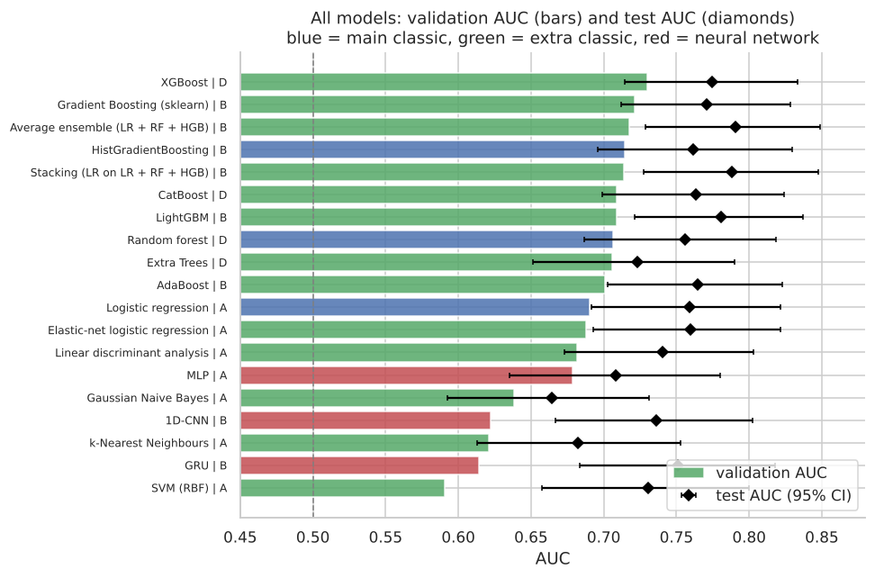
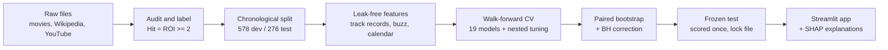
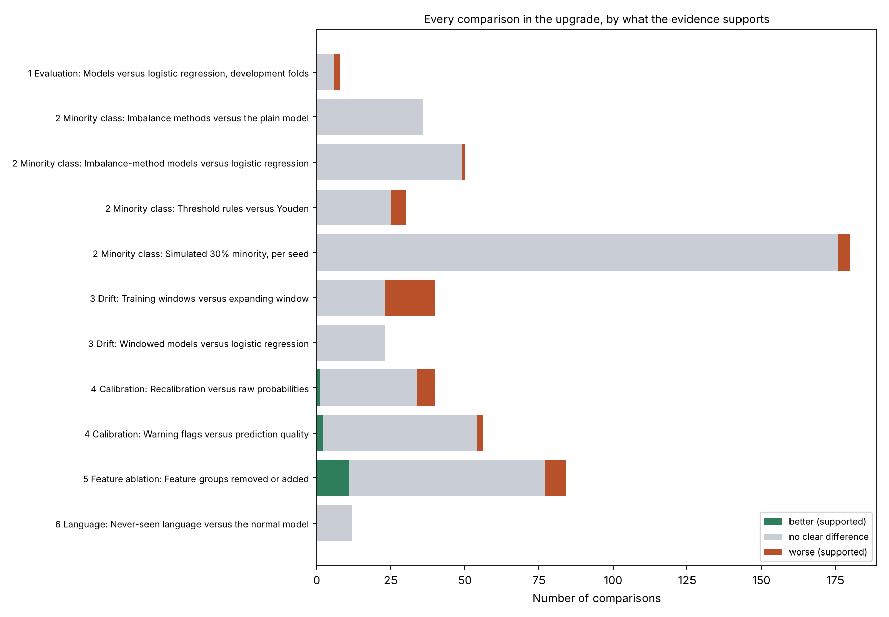
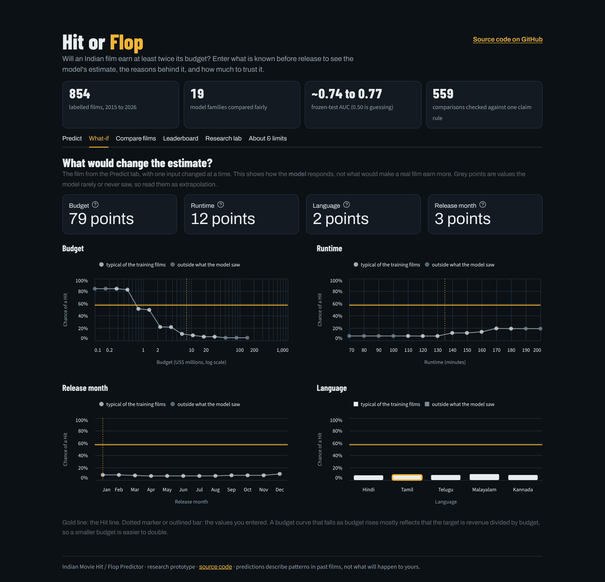
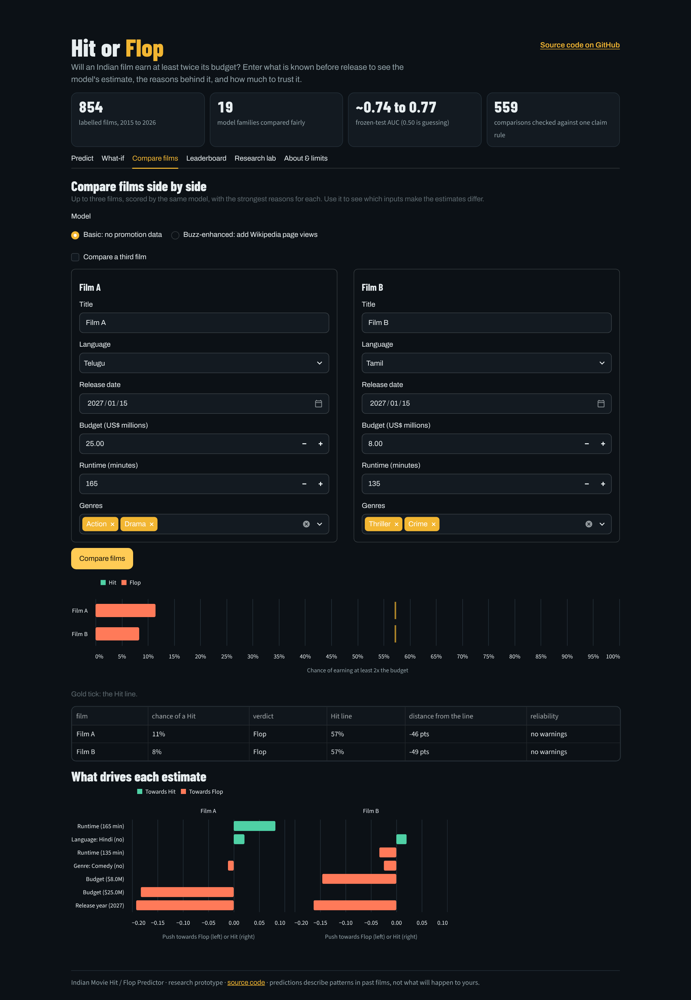
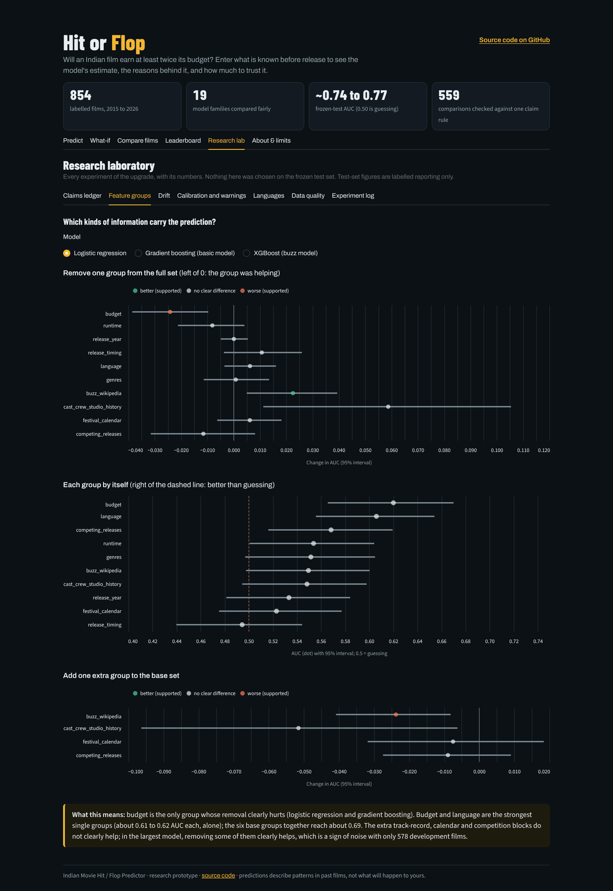

<div align="center">

# 🎬 Indian Movie Hit / Flop Prediction

**Can we tell, before release, whether an Indian film will earn at least twice its budget?**
A leak-free, chronologically validated machine-learning study of 854 films: 19 models compared, a research upgrade where every claim is checked against one statistical rule, and an interactive dashboard.

[](https://github.com/tonymadhuri2088-cmd/movie-hit-flop/actions/workflows/ci.yml)
[](https://movie-hit-flop-predictor.streamlit.app/)


[](LICENSE)

[**Live app**](https://movie-hit-flop-predictor.streamlit.app/) · [Results](#results) · [Research upgrade](#research-upgrade) · [Dashboard](#the-dashboard) · [Quick start](#quick-start) · [Model card](docs/MODEL_CARD.md) · [Upgrade log](docs/UPGRADE_LOG.md) · [Architecture](docs/ARCHITECTURE.md)


</div>

> The free live app sleeps when idle. If it shows "Wake up", click once and wait about a minute.

## Highlights
- **Honest evaluation.** Hit = revenue / budget >= 2. Every split is chronological (never shuffled): 578 development films before 2023, and **276 frozen test films from 2023 onward, scored once**.
- **19 model families** (logistic regression to gradient boosting, stacking and neural networks) compared with paired bootstrap and Benjamini-Hochberg correction.
- **Leak-free features.** Cast, crew and studio track records use only earlier films. Tests flip future labels and prove earlier features do not move.
- **One claim rule for everything.** A result is called better or worse only if its paired-bootstrap 95% interval excludes 0 and its Benjamini-Hochberg q-value is below 0.05. An automatic audit re-checks all 559 comparisons in the upgrade; otherwise the wording is "no clear difference".
- **A real, tested product.** 151 automated tests, lint, coverage and a Docker build checked on every push by GitHub Actions, and a dark Streamlit dashboard with prediction explanations, what-if curves, side-by-side film comparison and uncertainty warnings.

## Results
Test AUC on the 276 frozen 2023+ films (0.50 = chance), with 95% bootstrap intervals:

| Model | Features | Validation AUC | Test AUC (95% CI) |
|---|---|---|---|
| XGBoost (best on validation) | base + Wikipedia + YouTube | 0.730 | 0.774 (0.714 to 0.833) |
| HistGradientBoosting (cross-validation choice) | base + Wikipedia | 0.714 | 0.761 (0.696 to 0.830) |
| Random forest | base + Wikipedia + YouTube | 0.706 | 0.756 (0.687 to 0.818) |
| Logistic regression (simple baseline) | base | 0.690 | 0.759 (0.692 to 0.822) |
| MLP / 1D-CNN / GRU | various | 0.61 to 0.68 | 0.71 / 0.74 / 0.75 |

<p align="center"></p>

Full table: [`docs/MODEL_LEADERBOARD.md`](docs/MODEL_LEADERBOARD.md).

**What this shows**
1. **Hits can be ranked better than chance** (test AUC about 0.76), but only moderately. At the threshold chosen on development data the deployed models find about a third of the Hits (recall 0.33 to 0.34) and about 94% of the Flops; accuracy of 76% is only 6 points above always answering Flop.
2. **No model is convincingly better than logistic regression.** All paired-bootstrap intervals include 0 on the held-out period, so the top model families are statistically tied.
3. **Neural networks do not help.** They are lower on validation and no better on test, as expected with 578 training films.
4. **Pre-release "buzz" (Wikipedia page views, YouTube trailer statistics) adds little.** In the research package, 0 of 48 feature-set comparisons were convincing, and tuning and ensembling did not help either.
5. **The ceiling is the data, not the algorithm.** Budget and language dominate. See the [roadmap](docs/IMPROVEMENTS.md) for what would actually move the needle.

## How it works

More detail: [`docs/ARCHITECTURE.md`](docs/ARCHITECTURE.md).

## Two parts
| Part | What it is | Where |
|---|---|---|
| **A. Course notebook** | One notebook that compares **19 model families** end to end. Runs in Google Colab in about 30 minutes. | `notebooks/01_course_notebook_19_models.ipynb`, results in `docs/course_notebook_results/` |
| **B. Research package** | The same question as a tested Python package: nested tuning, ensembles, calibration, SHAP, a frozen test set scored once, and the Streamlit app. | `hitflop/`, `tests/`, `app/`, `outputs/` |

The two parts use different feature sets and validation set-ups, so exact numbers differ slightly (for example HistGradientBoosting test AUC 0.761 in A and 0.735 in B). The conclusions agree.

## Research upgrade
The project was upgraded phase by phase into a research-grade study **without touching the original split, the test lock or the original results**. Every experiment uses development films only, the same five chronological folds, and the claim rule above. Full method, numbers and caveats: [`docs/UPGRADE_LOG.md`](docs/UPGRADE_LOG.md).

| Phase | Question | Honest finding |
|---|---|---|
| 1. Evaluation | What do precision, recall, MCC, PR-AUC, Brier and calibration say? | Same story as AUC. At the development-chosen threshold the models catch about a third of Hits; accuracy flatters them. |
| 2. Minority class | Do class weights, Balanced RF, SMOTE-NC or other threshold rules help find Hits? | **No.** All 36 method-versus-plain comparisons are "no clear difference"; no threshold rule beat the original Youden rule. |
| 3. Drift | Does the Hit rate move, and does forgetting old films help? | The Hit rate fell from 47% (before 2023) to 30% (2023+). Rolling windows and time-decay weights never helped; 17 of 40 comparisons were clearly worse. |
| 4. Calibration and uncertainty | Can recalibration or warnings fix over-confident probabilities? | No recalibration helped the deployed models (isotonic clearly hurt). The "close call" warning is the one evidence-backed signal: accuracy 40% versus 67% for close calls on development folds. |
| 5. Feature ablation | Which kinds of information carry the prediction? | Budget is the only group whose removal clearly hurts. Language alone reaches AUC about 0.61. The extra track-record, calendar and competition blocks do not clearly help. |
| 6. Languages | How does it behave inside each language and for a language it never saw? | Clearly above chance in Telugu and Tamil (and Malayalam for the boosted models). **Not** clearly above chance in Hindi, the largest group. No clear loss for an unseen language, but the intervals are wide. |
| 7. Old versus new | Did the upgrade produce a better model? | **No, and the repository does not claim it.** 559 comparisons: 14 better, 44 worse, 501 no clear difference. The 14 are feature-removal comparisons (11), one 0.002 Brier gain for the earlier headline model, and two warning flags that happen to mark easier films. None is a new deployed model. |
| 8. Dashboard | Can a reader inspect all of this? | A dark analytics dashboard: predict, what-if, compare films, leaderboard, research lab. |
| 9. Engineering | Is it reproducible and checked? | 151 tests, ruff, coverage, a Docker build and app smoke test on every push, model card and citation file. |

<p align="center"></p>

Re-run any phase (outputs go to `outputs/upgrade/`, runs are logged in `experiments/experiment_log.jsonl`):
```bash
python -m hitflop.upgrade_phase1 outputs/upgrade/part_a_test_predictions.pkl   # all metrics, intervals, confusion matrices
python -m hitflop.upgrade_phase2   # class weights, Balanced RF, SMOTE-NC, threshold rules (about 5 minutes)
python -m hitflop.upgrade_phase3   # Hit-rate and input drift, rolling windows, time-decay weights (about 3 minutes)
python -m hitflop.upgrade_phase4   # calibration, recalibration, warning evaluation (under a minute)
python -m hitflop.uncertainty      # attach the warning references to the model artifact (no refit)
python -m hitflop.upgrade_phase5   # feature-group ablation (about 6 minutes)
python -m hitflop.upgrade_phase6   # language-wise performance and leave-one-language-out (about 5 minutes)
python -m hitflop.upgrade_phase7   # collects every comparison and audits the claim rule
```

## Tech stack
| Area | Tools |
|---|---|
| Language | Python 3.11+ |
| Data | pandas, NumPy, SciPy |
| Classic models | scikit-learn (logistic regression, random forest, HistGradientBoosting, SVM, kNN, Naive Bayes, LDA, AdaBoost, Extra Trees), XGBoost, LightGBM, CatBoost |
| Neural networks (Part A) | PyTorch (MLP, GRU, 1D-CNN) |
| Tuning and explanation | Optuna (nested chronological tuning), SHAP, permutation importance |
| Features | `holidays` package for festival and holiday calendars |
| Imbalance | imbalanced-learn (Balanced Random Forest, SMOTE-NC inside training folds) |
| Statistics | paired bootstrap, Benjamini-Hochberg correction |
| App | Streamlit, Altair |
| Quality | pytest (151 tests) and coverage, ruff, GitHub Actions CI (lint, tests on Python 3.11 to 3.13, Docker build and app smoke test), pre-commit |
| Notebook | Google Colab / Jupyter, matplotlib, seaborn |

## Data and split
- 854 films with both budget and revenue: **578 development (released before 2023-01-01)** and **276 frozen test (2023 onward)**. Seed 42.
- Features known before release: budget, language, genre, runtime, release timing and festivals, Wikipedia page-view rates, YouTube trailer statistics, and cast/crew/studio track records (only from films released at least 120 days earlier).
- The test set is scored once. In Part B a lock file (`outputs/final/TEST_SCORED.lock`) refuses a second run.

## The dashboard
Six tabs, all dark-themed and backed by the files the experiments wrote:

| Tab | What it gives you |
|---|---|
| **Predict** | Film details in; chance of a Hit, a verdict with the decision threshold, per-input explanation bars, uncertainty warnings, CSV download, quick example films. |
| **What-if** | The same film with budget, runtime, language or release month changed one at a time. Values the model rarely saw are greyed out. |
| **Compare films** | Two or three films scored side by side, with the strongest reasons for each. |
| **Leaderboard** | The 19 models ordered by validation or test AUC, a validation-versus-test plot, and a full metric panel with intervals. |
| **Research lab** | Claims ledger, feature groups, drift, calibration and warnings, languages, data quality, experiment log. |
| **About & limits** | What this is, and what it cannot tell you. |

<p align="center">


</p>
<p align="center">


</p>

## Quick start
```bash
git clone https://github.com/tonymadhuri2088-cmd/movie-hit-flop.git
cd movie-hit-flop
pip install -r requirements-dev.txt   # runtime packages plus pytest, coverage and ruff
python -m pytest                   # 151 tests: cohort, leakage, folds, metrics, protocol, calibration, language, ablation, dashboard, app
streamlit run app/streamlit_app.py
```
Shortcuts: `make test`, `make cov`, `make lint`, `make app`, `make docker`. Contributor rules are in [`CONTRIBUTING.md`](CONTRIBUTING.md).

**Part A (notebook):** open `notebooks/01_course_notebook_19_models.ipynb` in Google Colab and choose Runtime > Run all (about 30 minutes). The first cell downloads the two data files automatically; if that fails, Colab shows an upload button, so upload `data/movies_full.csv` and `data/yt_features.csv` from this repo. Locally, also run `pip install -r requirements-notebook.txt`.

**Docker** (the image is built and the app is health-checked on every push by GitHub Actions):
```bash
docker build -t movie-hit-flop .
docker run -p 8501:8501 movie-hit-flop   # then open http://localhost:8501
```

**Re-create Part B results:**
```bash
python -m hitflop.pipeline_phase1; python -m hitflop.phase3; python -m hitflop.phase45
python -m hitflop.final            # scores the frozen test set ONCE (lock file)
python -m hitflop.artifacts; python -m hitflop.phase6
```

## Repository map
```
hitflop/        package: data, features, history (leak-free records), models, validation, metrics, calibration,
                tuning, ensembles, explain (SHAP), predict, final; upgrade modules (protocol, imbalance, thresholds,
                temporal, drift, recalibration, uncertainty, ablation, language, ledger) and one runner per phase
hitflop/dashboard/  dashboard logic (what-if, comparison, leaderboard), theme, charts and panels
tests/          151 tests, including leakage tests that flip future labels and check earlier features do not move
app/            Streamlit entry point and fonts (.streamlit/ holds the theme)
notebooks/      01 = 19-model course notebook, 02 = upgrade experiments
experiments/    append-only experiment log (every experiment, settings and result)
outputs/        Part B tables and figures
docs/           what is done, roadmap, architecture, model card, 19-model leaderboard, figures, screenshots
data/           labelled movies, Wikipedia infobox records, YouTube features
```

## Method notes
- **Validation:** expanding-window walk-forward (chronological). Tuning uses a nested inner chronological split.
- **Comparisons:** paired bootstrap on identical films with Benjamini-Hochberg correction. "Convincing" means the interval is above 0 and the adjusted q < 0.05.
- **Leakage controls:** track records use only earlier films, and label-flip perturbation tests prove it. The Hit threshold (2.0) is fixed; 1.5 and 2.5 are sensitivity checks only.
- **Calibration:** recalibration fitted on earlier folds was tested (Platt, isotonic, intercept shift); none was supported as better for the deployed models and isotonic was clearly worse, so none is used. The Hit rate drifts (47% before 2023, 30% after) and predictions run high for recent films.
- **Test set:** it was scored once in the original study, so it is a reporting arena only. Nothing in the upgrade was chosen on it.

## Limits
- Predictive, not causal. SHAP explains the model, not the real world.
- Only 854 of 4,273 films have budget and revenue, and they are not a random sample (a selection model separates labelled from unlabelled films with AUC 0.86).
- Money is in US dollars as stored; whether it is gross or net is undocumented.
- YouTube collection dates are missing, so YouTube features cannot be proven to be pre-release.
- Hindi is the weakest language: inside Hindi the AUC is about 0.56 and its interval includes 0.50. Kannada has too few films (25 in development) to judge.
- Library versions matter: scikit-learn and the `holidays` package change results slightly (AUC within about 0.02, same conclusions).
- Not a financial tool. Do not use it to decide whether to invest in a film.

## Data note
The data files were compiled from public sources (movie metadata, Wikipedia page views and infoboxes, YouTube trailer statistics). Check each source's terms before reusing or redistributing the data.

## Cite
See [`CITATION.cff`](CITATION.cff) (GitHub shows a "Cite this repository" button).

## Licence
MIT. See [LICENSE](LICENSE). The app bundles the Archivo and Barlow Condensed fonts (SIL Open Font License; see `app/static/ARCHIVO-OFL-LICENSE.txt` and `app/static/BARLOW-OFL-LICENSE.txt`).
