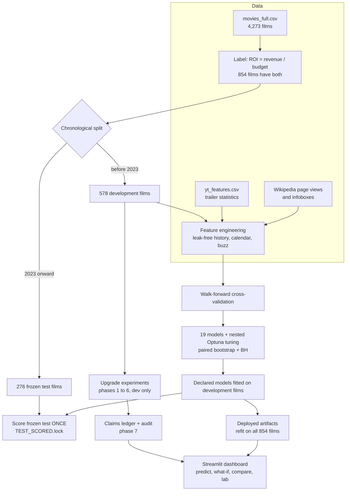

# Architecture and design decisions

## Pipeline

## Key decisions
| Decision | Why |
|---|---|
| Chronological splits, never random | Random shuffling lets later films inform earlier ones and inflates scores. |
| Test set frozen and scored once | Prevents choosing a model by its test score. A lock file enforces it. |
| Track records use only films released at least 120 days earlier | Box-office results are not known sooner. Label-flip tests prove no leakage. |
| Paired bootstrap + Benjamini-Hochberg | Many comparisons were made, so adjusted p-values stop chance wins being reported as findings. |
| Hit threshold fixed at ROI 2.0 | 1.5 and 2.5 are reported only as sensitivity checks. |
| No probability recalibration in the app | Platt, isotonic and intercept-shift recalibration were tested on earlier folds; none was supported as better for the deployed models (isotonic was clearly worse), because the Hit rate drifts. |
| One claim rule everywhere | A result is better or worse only if the paired-bootstrap 95% interval excludes 0 and the Benjamini-Hochberg q is below 0.05 over the whole family. `hitflop/ledger.py` audits all 559 comparisons automatically. |
| Upgrade experiments never touch the frozen test set | `protocol.ensure_dev_only` raises if a film from 2023 on reaches an experiment; test numbers in the upgrade are reporting only. |
| Two model modes (basic, buzz-enhanced) | Wikipedia views only exist for some films; the app lets you choose and warns when a result is weak. |

## Code layout
- `hitflop/data.py` loads and cleans, `features.py` builds features, `history.py` computes leak-free track records.
- `validation.py` makes walk-forward folds, `metrics.py` computes AUC, PR-AUC, Brier and bootstrap intervals.
- `tuning.py` and `ensembles.py` hold nested Optuna tuning and stacking.
- `explain.py` wraps SHAP, `predict.py` serves the app, `final.py` scores the frozen test set once.
- Upgrade layer: `protocol.py` (rules, guards, logging), `evaluation.py` (metrics with intervals), `imbalance.py` and `thresholds.py`, `temporal.py` and `drift.py`, `recalibration.py` and `uncertainty.py`, `ablation.py`, `language.py`, `ledger.py`; one runner per phase (`upgrade_phase1.py` to `upgrade_phase7.py`) writing to `outputs/upgrade/`.
- `dashboard/` holds the dashboard: `logic.py` (what-if, comparison, leaderboard; no Streamlit), `theme.py`, `charts.py`, `panels.py`. `app/streamlit_app.py` only wires the tabs.
