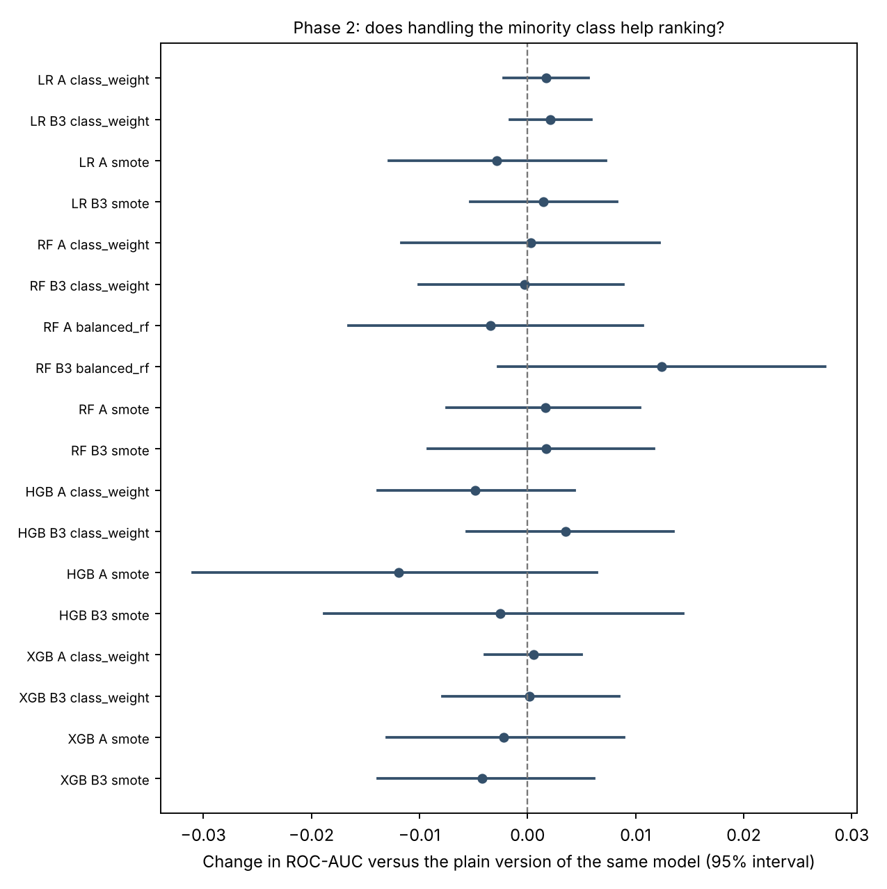
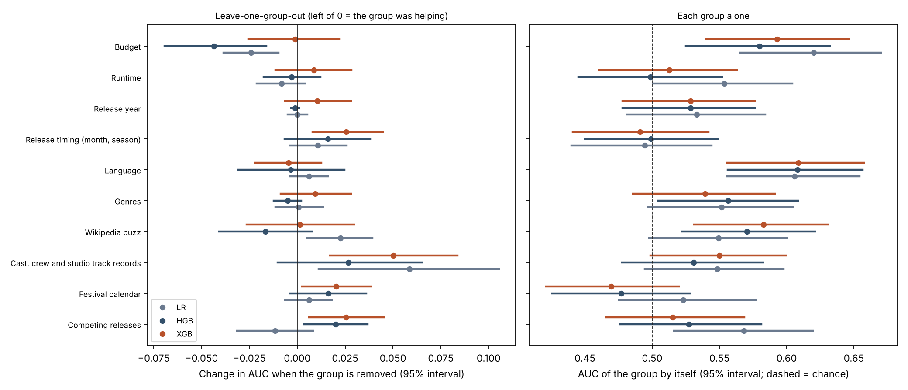
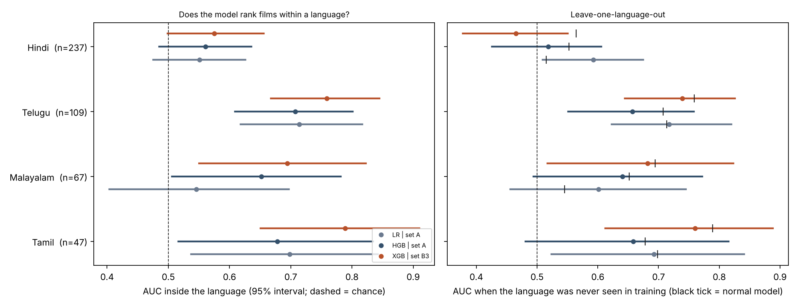
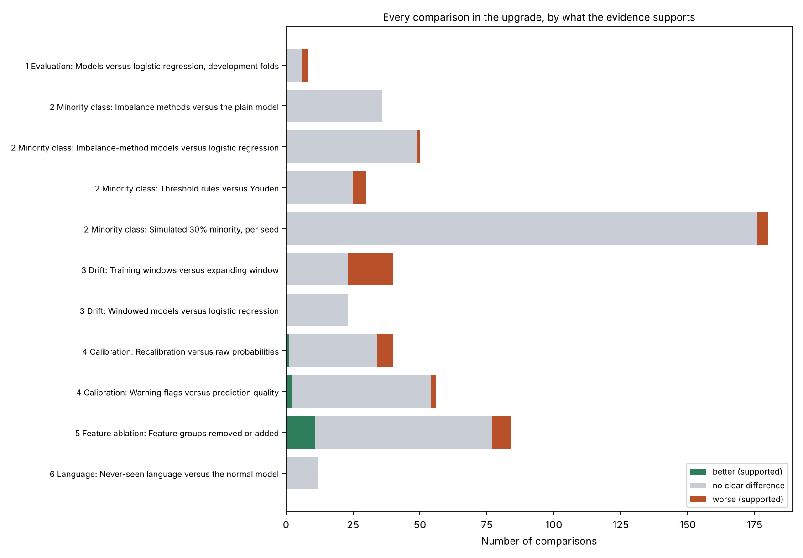

# Research upgrade log

This log records the research upgrade of the project, one phase at a time. The original study is preserved: the chronological split (578 development films before 2023, 276 frozen test films from 2023), the one-time test scoring and its lock file, the leak-free history features, the 19-model course notebook and every stored result.

## Rules for every upgrade experiment (`hitflop/protocol.py`)
1. **Development data only.** New experiments never see the frozen test set. `ensure_dev_only` and `dev_only_world` raise or exclude it.
2. **Chronological validation.** The same 5 expanding-window folds as the original study (480 validated films).
3. **Thresholds from earlier data only.** `expanding_threshold` picks the threshold for each validation block from earlier blocks, and a test flips later labels to prove it.
4. **One comparator and one claim rule.** The comparator is logistic regression on the base features. A result is called better or worse only if the paired bootstrap 95% interval excludes zero and the Benjamini-Hochberg adjusted p-value is below 0.05, corrected over the whole family of comparisons in a run. Otherwise the wording is "no clear difference".
5. **Everything is logged.** `log_run` writes configuration, versions, seed and results to `experiments/experiment_log.jsonl` and refuses to log test-set use outside the final scoring.
6. **Primary metric is AUC**, as in the original study. Other metrics are secondary, so a gain found only in a secondary metric is not claimed.

**About the frozen test set.** It was scored once in the original study and its results are already published in this repository. It therefore cannot be a clean selection arena for new ideas. All decisions in the upgrade are made on development folds. Test-set numbers produced during the upgrade are marked *reporting only* and are computed from the stored predictions of that one scoring, with nothing refitted, tuned or selected.

---

## Phase 0: protocol and reproducibility guard (done)
- Added `hitflop/protocol.py` (rules above) and `tests/test_protocol.py`.
- A guard test confirms the stored development predictions still reproduce the AUC recorded in the original study (logistic regression, base features: 0.6858 on 480 films) to 9 decimals, and that the test lock file exists.

## Phase 1: advanced evaluation (done)
**What was added** (`hitflop/evaluation.py`, `hitflop/upgrade_phase1.py`, `tests/test_evaluation.py`): precision, recall (Hit recall), specificity (Flop recall), F1 of the Hit class, macro-F1, balanced accuracy, Matthews correlation (MCC), PR-AUC, Brier score, log-loss, calibration error and the confusion matrix, each with a bootstrap 95% interval (1,000 resamples, seed 42). The metric formulas are unit-tested against scikit-learn.

**What was scored:** the four named specs (logistic regression on base features as comparator, the deployed basic model, the deployed buzz model, the earlier XGBoost headline) plus a no-skill reference, in three ways.

| Scoring | Films | Threshold | File |
|---|---|---|---|
| Development, out-of-fold | 480 | fixed 0.5 | `outputs/upgrade/phase1/dev_metrics_threshold_0.5.csv` |
| Development, out-of-fold | 384 (blocks 2 to 5) | from earlier blocks only | `outputs/upgrade/phase1/dev_metrics_expanding_youden.csv` |
| Frozen test, **reporting only** | 276 | development Youden point, and 0.5 | `outputs/upgrade/phase1/test_metrics_reporting_only.csv` |
| 19 course-notebook models, test, **reporting only** | 276 | validation Youden point | `outputs/upgrade/phase1/part_a_19_models_test_metrics_reporting_only.csv` |

The Part A predictions were regenerated by re-running the notebook models with the same seed and settings. AUC, accuracy and confusion counts matched the saved results exactly.

**Findings**
- The extra metrics tell the same story as AUC. On the frozen test set the basic and buzz models both reach balanced accuracy 0.64 (about 0.58 to 0.70) and macro-F1 0.65, against 0.63 and 0.64 for logistic regression. The intervals overlap almost completely.
- At the development-chosen threshold the models catch about a third of the Hits (recall 0.33 to 0.34) and about 94% of the Flops. Accuracy of 76% is only 6 points above always answering Flop (70.3%), so accuracy alone flatters the models.
- On development folds, no model is clearly better than logistic regression on AUC or PR-AUC after correcting across both metrics. The buzz model's PR-AUC gain (+0.046, interval 0.007 to 0.085) has an adjusted p-value of 0.059 and is **not** claimed.
- In the 19-model table the neural networks (GRU, 1D-CNN) and random forest catch more Hits at their validation thresholds, with higher balanced accuracy and MCC (GRU MCC 0.41), but they also call more Flops Hits, and their intervals overlap the others. This is a trade-off between error types, not evidence of a better model. Phase 2 tests it (result: it is a different operating point, not a better model).

**Claims allowed after Phase 1:** none new. Phase 1 adds measurement only and changes no model.

---

## Phase 2: minority-class Hit detection (done)
**What was added** (`hitflop/imbalance.py`, `hitflop/thresholds.py`, `hitflop/upgrade_phase2.py`, `tests/test_imbalance.py`): class weighting, Balanced Random Forest, SMOTE-NC and six threshold rules, all on development data with the original expanding-window folds and the original inner tuning grids. The plain versions of logistic regression and HGB reproduce the stored out-of-fold predictions exactly (checked by a test and by an assertion in the runner).
- **Class weighting:** the loss weights a Hit more than a Flop according to the training rows (logistic regression, random forest, HGB, XGBoost).
- **Balanced Random Forest:** `imbalanced-learn`, every tree grown on a balanced bootstrap.
- **SMOTE, carefully controlled:** SMOTE-NC runs after preprocessing and inside an `imbalanced-learn` pipeline, so synthetic rows are added only to the rows a model trains on (and only to the inner training part inside the tuning search). Yes/no columns such as genre flags, one-hot language and missing-value indicators stay yes/no. Tests check that the original rows are untouched, that prediction never resamples, and that nothing happens when the classes are already balanced.
- **Threshold rules:** fixed 0.5, Youden (the original rule), maximum Hit-F1, maximum MCC, prior-matched, and a Hit-recall target of 60%. Each is chosen from earlier validation blocks only; a test corrupts later blocks and checks that no threshold moves.

**Three experiments** (outputs in `outputs/upgrade/phase2/`)
1. *Natural setting:* 4 models x 2 feature sets (base, and base + three Wikipedia page-view windows) x every method, tuned, on the 480 validated films. Every method is compared with the plain version of the same model, and every model with the logistic-regression comparator.
2. *Threshold rules:* six specs x six rules on blocks 2 to 5 (384 films), each rule compared with Youden.
3. *Simulated minority:* Hits randomly dropped until they are 30% of the films (the development data is 47% Hits), five seeds, untuned models, because in the natural folds the training rows are already about 47 to 50% Hits and there is little for weights or SMOTE to correct.

**Findings**
- **No method clearly improved anything.** All 36 method-versus-plain comparisons (AUC and balanced accuracy at 0.5) are "no clear difference"; the adjusted p-values are 0.97. The largest AUC change is Balanced Random Forest on the buzz features, +0.012 (interval -0.003 to +0.028).
- **Against logistic regression** (50 comparisons, AUC and PR-AUC) only one difference is supported: logistic regression with buzz features is *worse* than logistic regression without them (-0.024, interval -0.041 to -0.008). No model is supported as better than logistic regression. This agrees with Phase 1.
- **Class weights move errors around, they do not remove them.** In the simulated minority, logistic regression's Hit recall at 0.5 rises from 0.37 to 0.60 while its Flop recall falls from 0.83 to 0.59; balanced accuracy is unchanged (0.597 to 0.597). Balanced Random Forest does the same for random forest (Hit recall 0.31 to 0.52). That is a different operating point, not a better model.
- **SMOTE tended to hurt.** In the simulated minority the mean AUC change was negative in all 8 model and feature-set configurations (-0.002 to -0.043), and individually supported as worse in 1 of 5 seeds for four of them. Seeds share the same Flops, so they are not independent evidence and the overall verdict stays "no clear difference". SMOTE is therefore **not** recommended here.
- **Threshold rules:** fixed 0.5, Youden, maximum MCC, prior-matched and the 60%-recall rule cannot be told apart. Maximum Hit-F1 is supported as *worse* in 5 of 6 specs (balanced accuracy 0.52 to 0.55 against 0.63): it calls almost everything a Hit (Hit recall 0.81 to 0.97, Flop recall 0.08 to 0.33). The original Youden rule stays.

**Claims allowed after Phase 2:** none new that favour a method. Allowed negative statements: maximum-F1 thresholding is worse than Youden in this data; buzz features do not help logistic regression on development folds. The deployed models and thresholds are unchanged.

**Why this is useful for the report:** class imbalance is mostly a *shift* in this project (47% Hits in development, 30% in the test period), not a small-minority problem inside the training data. Rebalancing the training rows cannot fix a shift in the future Hit rate, and the honest answer is to say so.

---

## Phase 3: temporal drift (done)
**What was added** (`hitflop/drift.py`, `hitflop/temporal.py`, `hitflop/upgrade_phase3.py`, `tests/test_temporal_drift.py`): Hit-rate trend and input-drift measures, per-block model behaviour, and two ways of forgetting the past: rolling training windows (the 150 or 250 most recent earlier films) and time-decay weights (a film that is 1, 2 or 4 years older counts half as much). Weights come from release dates only. Validation blocks, tuning grids and scoring are the original ones, and expanding-window logistic regression and HGB reproduce the stored predictions exactly.

**Test-set use in this phase:** label-free only. The frozen test films' *features* (no revenue, ROI or Hit label; a test asserts this) are used to measure how far the inputs have moved. The already-published test Hit rate (29.7%) is quoted for context. No model was fitted, tuned or selected with the test set.

**Findings**
- **The Hit rate is lower in recent years, but within development alone the trend is not statistically clear.** About 50% of films were Hits in each year 2015 to 2019 (452 films, 227 Hits), then 36%, 32% and 38% in 2020 to 2022 (126 films, 45 Hits, 36%), then 29.7% in the frozen test period. Inside development, the later half of the films has a Hit rate 6.2 points lower than the earlier half (50.2% to 43.9%), with an interval of -14.5 to +1.7 points and Kendall p = 0.068, so that alone is not a supported finding. The 2020 break is chosen by eye and is descriptive; the data cannot say whether the cause is the pandemic, streaming or something else.
- **Models over-predict Hits in the later blocks.** Mean predicted Hit probability exceeded the actual Hit rate by 0.05 to 0.14 in validation blocks 4 and 5 (2019 to 2022) for all four reference models, against within +/-0.05 in blocks 1 to 3. The models learned from a period with more Hits. This is the clearest sign of drift, and it is a calibration problem more than a ranking problem: AUC per block does not fall (block 5 AUC is 0.69 to 0.84, with wide intervals of about +/-0.1 on 96 films).
- **Inputs have moved too.** Between the earlier and later development films, budget (PSI 0.13, moderate, standardised shift +0.29) and buzz-per-budget (0.19, moderate) shifted. Between development and the frozen test films the shift is larger: buzz-per-budget PSI 0.41 and budget 0.27 are *large* (above the usual 0.25 rule of thumb), runtime 0.13 and early page views 0.21 are moderate. Language, season and genre mix moved little (PSI at most 0.07).
- **Forgetting the past did not help.** Of 40 comparisons with the expanding window of the same model (AUC and Brier together), 17 are supported as *worse* and none as better. Rolling windows hurt the tree models most (for example XGBoost, buzz features: AUC 0.718 expanding, 0.678 rolling-250, 0.649 rolling-150). Logistic regression is not affected, and a 4-year half-life is indistinguishable from the expanding window. Short windows give a few calibration gains in the last block but lose more ranking quality than they gain.
- **No windowed model is better than the logistic-regression comparator.** All 23 comparisons are "no clear difference".

**Decision:** keep the original expanding window. **Claims allowed after Phase 3:** (a) the Hit rate in this data is lower for 2020 onward than for 2015 to 2019 (descriptive, intervals in `hit_rate_by_year.csv`); (b) the models over-predict Hits in recent blocks; (c) the inputs of the test period differ from development, most in budget and buzz-per-budget; (d) rolling windows and short half-lives are worse than the expanding window for tree models. Not claimed: any cause of the drift, or a significant trend inside development.

**Hand-over to Phase 4:** over-prediction and input shift are exactly what an uncertainty warning should flag, so Phase 4 will measure calibration by block and build an input-shift (out-of-distribution) check.

---

## Phase 4: calibration, out-of-distribution detection and uncertainty warnings (done)
**What was added** (`hitflop/recalibration.py`, `hitflop/uncertainty.py`, `hitflop/upgrade_phase4.py`, `tests/test_uncertainty.py`, two app tests): reliability, calibration slope and intercept, five recalibration methods fitted on earlier validation blocks only, an out-of-distribution (Mahalanobis) check with range rules, and tiered warnings in the app. For this phase the primary metric is the **Brier score** (declared before the run), because recalibration with a monotone map cannot change the ranking inside a block.

**Calibration findings (development blocks 2 to 5, 384 films)**
- Raw probabilities run high: mean predicted Hit chance 0.49 to 0.52 against an observed 0.458, calibration intercept -0.14 to -0.30 (0 is ideal), calibration slope 0.75 to 0.94 (1 is ideal; below 1 means too extreme), calibration error 0.07 to 0.10. Reliability curves lie below the diagonal in the middle of the range.
- **Recalibration did not help.** Of 40 comparisons with the raw probabilities (Brier and log-loss, 5 methods, 4 models), 6 are supported as *worse* (every one of them isotonic regression, which overfits 96-film blocks) and 1 as better: an intercept shift for the earlier-headline XGBoost model, +0.002 Brier. That gain is tiny, is not for a deployed model, and is not acted on. For the two deployed models no recalibration is supported as better.
- **Test set, reporting only.** Recalibrators fitted on development predictions and applied to the stored test predictions: an intercept shift from the two most recent development blocks lowers the basic model's average predicted chance from 0.395 to 0.331 (observed 0.297) and its Brier score by 0.009 (interval 0.001 to 0.015), but the same method does nothing for the buzz model (+0.000) and does not help the earlier-headline model. This is consistent with the Phase 3 finding that the models over-predict Hits in recent films, and it is exactly the kind of result that must not be adopted from the test set. **Decision: the app keeps raw probabilities** and says they tend to run high. A recency-based update should be re-validated on films released after 2026 when they exist.

**Warning findings**
- **Close call (within 5 points of the Hit line) is the one warning the data supports.** Where the verdict was a close call on development films, it was right 40% of the time (basic model, 35 films) and 37% (buzz model, 49 films), against 67% and 69% elsewhere; both are supported after correction across the 48 testable comparisons. Logistic regression and the earlier-headline model show the same direction (not supported after correction). On the frozen test films, reporting only, the same direction appears for all four models, clearly for two (logistic regression: accuracy 0.43 versus 0.80, interval of the difference -0.53 to -0.21).
- **Input-shift flags do not mark worse predictions.** Films flagged as unusual by the Mahalanobis distance were not predicted worse on development data; for the earlier-headline model they were predicted *better* (accuracy 0.89 against 0.67, supported), and for all four models a larger distance goes with a *smaller* error (Spearman -0.10 to -0.19). The flag mostly catches films with unusually high page-view counts, which are easy Hits. So these flags are shown as neutral **notes** ("unusual compared with the training films") and the app does not claim they make the estimate less reliable.
- **Outside the seen range** (budget above about US$88 million or below about US$110 thousand, runtime outside 68 to 235 minutes) is shown as a **warning** because the model is extrapolating; no development film was ever outside the range of its training films, so this rule cannot be tested on outcomes and is stated as true by construction.
- **Input drift is visible in the flags.** The share of validation films flagged as unusual by the distance check was 1% to 8% in each block for the basic specs and 4% to 15% for the buzz specs; on the frozen test films it is 4% (basic) and 10% (buzz).

**In the app:** after each prediction, *high* (extrapolation) and *caution* (close call) messages appear as warnings, and notes appear as information boxes. The references behind them are stored in the model artifact (`artifacts/hitflop_models.joblib`, key `uncertainty`, built from the 854 films the deployed models were trained on); no model was refitted.

**Claims allowed after Phase 4:** (a) the probabilities run high, by about 3 to 6 points on average in validation and more in recent films; (b) isotonic recalibration is worse than raw probabilities; (c) a verdict within 5 points of the Hit line is close to a coin flip (and worse, for the deployed models). **Not claimed:** that any recalibration improves the models, or that unusual inputs predict worse errors.

---

## Phase 5: feature ablation (done)
**What was added** (`hitflop/ablation.py`, `hitflop/upgrade_phase5.py`, `tests/test_ablation.py`): ten named feature groups, six in the base set (budget, runtime, release year, release timing, language, genres) and four optional extras (Wikipedia buzz, cast/crew/studio track records, festival calendar, competing releases). Three designs for logistic regression, gradient boosting and XGBoost, each with the original folds and inner tuning:
- **leave-one-group-out:** all ten groups, remove one;
- **group alone:** one group by itself, with its AUC interval tested against chance (0.5);
- **add-one:** the six base groups, add one extra group.

The preprocessing is the original one, so the base configuration reproduces the stored set-A predictions exactly (checked by a test and an assertion). 84 comparisons (42 AUC and 42 Brier) are corrected together.

**Findings (development folds, 480 films)**
- **Budget is the only group whose removal clearly hurts.** AUC falls by 0.024 for logistic regression (interval -0.039 to -0.010) and 0.044 for gradient boosting (-0.069 to -0.016); for XGBoost the change is not clear.
- **Language and budget are the strongest single groups.** Alone, language reaches AUC 0.61 and budget 0.58 to 0.62, both clearly above chance for all three models. Release timing, festival calendar, release year and cast/crew/studio history alone are not clearly above chance.
- **The extra groups do not clearly help.** Adding Wikipedia buzz to the base set is "no clear difference" for gradient boosting and XGBoost (+0.037 for XGBoost, q = 0.07, not claimed) and clearly worse for logistic regression (-0.024). Adding track records, festival calendar or competing releases is never supported as better.
- **The full ten-group sets are not better than the six base groups.** AUC with all groups: 0.608 (logistic regression), 0.664 (gradient boosting), 0.658 (XGBoost); base only: 0.686, 0.689, 0.681 (descriptive, not a tested family). In the largest model removing release timing (+0.026), track records (+0.050) or competing releases (+0.026) is supported as better, a sign that with 578 development films extra blocks add noise.
- Across all 84 comparisons: 11 supported as better, 7 as worse, 66 no clear difference.

**Decision:** deployed feature sets are unchanged (the basic model is the base set; the buzz model is the base set plus three Wikipedia windows). The pruned configurations found here were chosen on development folds, so their gains are not claimed as improvements to the deployed models. **Claims allowed after Phase 5:** budget carries signal that the other base groups do not replace; language alone carries about as much ranking signal as budget alone; the optional extras are not shown to help. **Not claimed:** that any pruned model is better than the deployed one.

---

## Phase 6: language-wise performance and robustness (done)
**What was added** (`hitflop/language.py`, `hitflop/upgrade_phase6.py`, `tests/test_language.py`): the three reference models' out-of-fold predictions split by language, and a leave-one-language-out test where the model is trained without a language and scored on it (expanding folds, tuned, only that language's films scored). A language is judged only with at least 30 validated films and 8 of each class; Kannada (20 validated films) is shown but never judged.

A first version compared each model with a "language-only" predictor inside a language. That predictor is nearly constant inside a language, so its within-language AUC (below 0.5) only reflects drift between folds and would have flattered the models. It was replaced by the proper question: does the AUC interval clear chance (0.5)?

**Findings**
- **Telugu (109 validated films) and Tamil (47):** AUC clearly above chance for all three models (for example Telugu 0.71 to 0.76, Tamil 0.68 to 0.79).
- **Malayalam (67):** above chance for gradient boosting (0.65, interval 0.51 to 0.78) and XGBoost (0.70, 0.55 to 0.82), not for logistic regression (0.55, 0.40 to 0.70).
- **Hindi (237, the largest group):** AUC 0.55 to 0.58, intervals include 0.50 for every model. Inside Hindi the models do not clearly rank Hits above Flops; the pooled AUC is helped by knowing the language.
- **How much of the pooled score is "which language"?** Pooled AUC 0.686, 0.689 and 0.718 (logistic regression, gradient boosting, XGBoost) against 0.604, 0.621 and 0.658 on average inside languages. A language-only predictor reaches a pooled AUC of 0.595 (and 0.5 inside a language by construction).
- **A language never seen in training:** no clear loss for any of the 12 model and language pairs; AUC changes between -0.099 (XGBoost, Hindi) and +0.078 (logistic regression, Hindi), all intervals include 0 and are about 0.2 wide. This does not show the models transfer to new languages; it shows this test cannot tell.

**Claims allowed after Phase 6:** the models rank films above chance within Telugu and Tamil, and for the boosted models within Malayalam; they do not within Hindi. **Not claimed:** that the models generalise to an unseen language.

---

## Phase 7: old versus new, with supported claims only (done)
**What was added** (`hitflop/ledger.py`, `hitflop/upgrade_phase7.py`, `tests/test_ledger.py`): one ledger of every comparison made in phases 1 to 6 (`outputs/upgrade/phase7/claims_ledger.csv`) and an **automatic audit** of the claim rule. The audit re-reads each row and fails if a "supported" verdict has a q-value of 0.05 or more or an interval that includes 0, or if a row with clear evidence is worded as "no difference". It found no violation; a test also proves it catches deliberately broken rows.

| Experiment | Comparisons | Better | Worse | No clear difference |
|---|---|---|---|---|
| 1. Models versus logistic regression | 8 | 0 | 2 | 6 |
| 2. Imbalance methods versus plain | 36 | 0 | 0 | 36 |
| 2. Imbalance-method models versus logistic regression | 50 | 0 | 1 | 49 |
| 2. Threshold rules versus Youden | 30 | 0 | 5 | 25 |
| 2. Simulated minority, per seed | 180 | 0 | 4 | 176 |
| 3. Training windows versus expanding | 40 | 0 | 17 | 23 |
| 3. Windowed models versus logistic regression | 23 | 0 | 0 | 23 |
| 4. Recalibration versus raw | 40 | 1 | 6 | 33 |
| 4. Warning flags versus quality | 56 | 2 | 2 | 52 |
| 5. Feature groups removed or added | 84 | 11 | 7 | 66 |
| 6. Never-seen language | 12 | 0 | 0 | 12 |
| **All** | **559** | **14** | **44** | **501** |

(The "no clear difference" count for the warning flags includes 8 flags with too few flagged films to test.)

**What the upgrade did and did not achieve.** It did **not** produce a better deployed model, and the repository does not claim it did. The 14 "better" rows are 11 feature-removal comparisons in Phase 5, one +0.002 Brier gain for the earlier headline model, and two warning flags that happen to mark easier films. What it did produce:
1. A measurement toolkit (metrics with intervals, confusion matrices, calibration, drift, ablation, language checks) and one claim rule enforced by tests.
2. Negative results that are reportable: imbalance methods, rolling windows, recalibration and extra feature blocks do not help here, and the reasons (distribution shift rather than small-minority training data; 578 development films).
3. Two things that change how the app is used: a close-call warning backed by evidence, and a clear statement that Hindi predictions are not better than guessing.

---

## Phase 8: dashboard (done)
**What was added** (`hitflop/dashboard/` and `app/streamlit_app.py`, `tests/test_dashboard.py`): the app was rebuilt as a dark analytics dashboard with six tabs.
- **Predict:** unchanged model and warnings, with the explanation chart restyled.
- **What-if:** Hit chance as budget, runtime, language or release month is varied one at a time. The curves are computed by re-deriving only the row-only features and re-scoring, and a test proves each point equals a full prediction to 9 decimals. Values outside the training range are greyed out.
- **Compare films:** two or three films scored with the same model, with the strongest reasons for each side by side. A film that cannot be scored is reported without stopping the others.
- **Leaderboard:** the 19 models ordered by validation or test AUC, a validation-versus-test plot, and a full metric panel with intervals for the four named models (development folds, and the frozen test as reporting only).
- **Research lab:** claims ledger, feature groups, drift, calibration and warnings, languages, data quality, experiment log. Every chart reads the CSVs the experiments wrote.
- **About & limits.**

Dashboard logic (what-if, comparison, leaderboard tables) lives in `hitflop/dashboard/logic.py` with no Streamlit dependency, so it is unit-tested directly; Streamlit's own test runner clicks through the app.

---

## Phase 9: engineering and documentation (done)
- **Lint:** `ruff` configured in `pyproject.toml`; the code base went from 147 findings to zero (a few dead variables removed, loop-variable bindings made explicit, imports sorted).
- **CI** (`.github/workflows/ci.yml`): lint; tests with coverage on Python 3.11, 3.12 and 3.13; and a Docker job that builds the image, starts the app, waits for the health endpoint and runs a prediction inside the container. The Dockerfile now runs as a non-root user with a health check.
- **Project files:** `CITATION.cff`, `CONTRIBUTING.md`, issue and pull-request templates, `Makefile`, `.pre-commit-config.yaml`, `requirements-dev.txt` (runtime requirements no longer include test tools).
- **Docs:** README rewritten around verified numbers (a confidence-interval typo for the random forest was fixed: 0.687 to 0.818), architecture and roadmap refreshed, model card updated with the upgrade evidence.

## Status
| Phase | Work | Status |
|---|---|---|
| 0 | Protocol and reproducibility guard | done |
| 1 | Advanced evaluation | done |
| 2 | Class weights, threshold rules, Balanced Random Forest, SMOTE inside training folds | done: no method clearly helps |
| 3 | Rolling windows, time-decay weights, drift analysis | done: expanding window kept; drift documented |
| 4 | Calibration, out-of-distribution detection, uncertainty warnings | done: close-call warning supported; recalibration not adopted |
| 5 | Feature ablation | done: budget matters; extra blocks not shown to help |
| 6 | Language-wise performance and robustness | done: Hindi not above chance |
| 7 | Combined comparison and claim audit | done: 559 comparisons, zero violations |
| 8 | Dashboard | done |
| 9 | Tests, Docker verification, CI, documentation | done (Docker is verified by GitHub Actions) |
